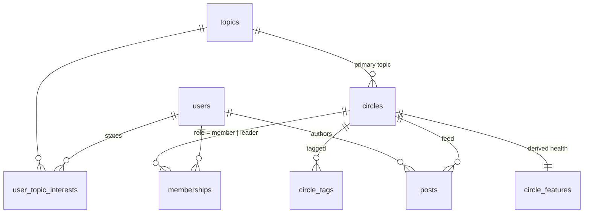

# Database schema

SQLite for the take-home (zero setup, ships with Python). The DDL is in [`app/schema.sql`](../app/schema.sql) and uses portable SQL, so moving to Postgres means changing types (`TEXT` timestamps → `timestamptz`), not the design.

| Table | Purpose | Key / indexes | Why |
| --- | --- | --- | --- |
| `topics` | Taxonomy (22 slugs) | PK `id`, UNIQUE `slug` | Slug is the join key everywhere; labels render explanations. |
| `users` | Member profile | PK `id` | Only `bio` and `location` feed the ranker. Title, company and industry are kept but not used (see design doc). |
| `user_topic_interests` | Stated interests (was a JSON array) | PK `(user_id, topic_slug)`, idx `topic_slug` | A join table, not a JSON column, so "members interested in X" is an index lookup (reverse use: notify members when a new Circle on their topic opens), and an interest can carry `source`/`weight` later. |
| `circles` | Circle profile + rolling aggregates | PK `id`, UNIQUE `slug`, idx `(access, topic_slug)` | Candidate generation is "public Circles on these topics", which the composite index serves directly. `member_count` is a denormalised counter so "is it full?" never needs a `COUNT(*)`. |
| `circle_tags` | Free-form tags | PK `(circle_id, tag)`, idx `tag` | Deliberately **not** FK'd to `topics`: tags are user-entered and will drift outside the taxonomy. The PK also dedupes repeated tags in the seed (Circle 17). |
| `memberships` | Who is in which Circle | PK `(user_id, circle_id)`, idx `(circle_id, role)` | The PK serves "Circles I'm already in" (exclusion); the secondary index serves "leaders of Circle X" and per-Circle member lookups (location proxy). Leaders are just `role = 'leader'`, with no separate table. |
| `posts` | Feed activity | PK `id`, idx `(circle_id, created_at)` | Engagement roll-ups read "posts for Circle X in the last 30 days", which is a range scan on this index. |
| `circle_features` | **Derived** health per Circle: `is_full`, `is_inactive`, `engagement_per_post`, `health_score` | PK `circle_id` | Computed offline (here at seed time; in production a scheduled job). The request path reads one row per Circle and never aggregates raw posts. Also makes the activity definition auditable: you can `SELECT` why a Circle is considered dormant. |
| `dataset_meta` | `snapshot_as_of` | PK `key` | The seed is a frozen snapshot, so "now" for recency is the snapshot time, not the wall clock (override with `RECS_AS_OF`). |

**Not stored on purpose:** recommendations themselves (cheap to compute at this size; see the production notes in the design doc for when to precompute them), and any chat message text, of which only aggregates exist.
